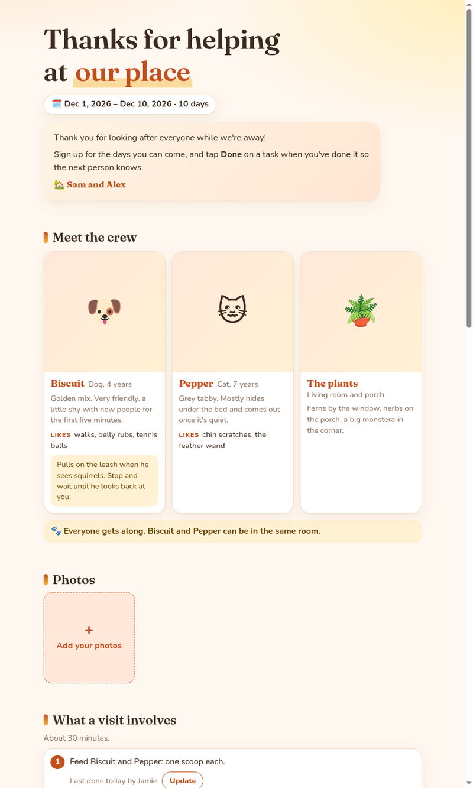

# Home Help

A small, friendly web page for the people helping out at your place while you're away:
pet sitting, plant watering, house watching, or anything else.

Helpers can:

- **Sign up for days** on a shared calendar (and change or remove their sign-up)
- **Tick off tasks** ("Fed the dog", "Watered the plants"), so the next person knows what's
  done and what's due
- **Add photos** to a shared gallery, and **comment and reply** on them (comments show up live)
- Read everything they need to know: who's who, what a visit involves, where things are, how-tos

You change everything (words, pets, tasks, dates) in **one file, `site.json`**. No coding needed.



---

## Quick start

You need [Bun](https://bun.sh) (a free JavaScript runtime). For photo uploads you also need
[ImageMagick](https://imagemagick.org).

```sh
# 1. Install Bun (once)
curl -fsSL https://bun.sh/install | bash

# 2. Install ImageMagick (once), e.g. on Ubuntu/Debian:
sudo apt install imagemagick        # macOS: brew install imagemagick

# 3. Get the code and start it
git clone https://github.com/danielluzhu/home-help.git
cd home-help
bun server.js
```

Open **http://localhost:3000**. You'll see the example site for a dog, a cat and some plants.
Now make it yours.

To use a different port: `PORT=8080 bun server.js`.

---

## Make it yours

1. **Edit `site.json`** in any text editor.
2. **Save, then refresh the page.** No restart needed.
3. **Add photos** by putting them in the `photos/` folder and writing their file names in
   `site.json` (for example `"photo": "biscuit.jpg"`).

If you make a typo in `site.json`, the page tells you which line to look at.

### JSON in 30 seconds

`site.json` is a JSON file. The rules that trip people up:

- Text goes in **double quotes**: `"title": "Our place"`
- Put a **comma between items**, but **not after the last one**
- A quote inside text needs a backslash: `"A firm \"leave it\" works."`
- Lists use square brackets: `["one", "two"]`

In any text you can write `**bold**` and `[a link](https://example.com)`.

To remove a section, delete it from `site.json`. Sections you leave out don't appear.

---

## What goes in `site.json`

Here is every section, in the order it appears on the page. Look at the example `site.json`
alongside this; it uses all of them.

### The top

```json
"title": "Thanks for helping at our place",
"highlight": "our place",
"timeZone": "America/Los_Angeles",
"dates": { "start": "2026-12-01", "end": "2026-12-10" },
"welcome": ["First paragraph.", "Second paragraph."],
"signature": "🏡 Sam and Alex",
```

| Field | What it does |
|---|---|
| `title` | The big heading and the browser tab name |
| `highlight` | Part of the title to color (optional) |
| `timeZone` | Your home's time zone, so "today" and "due" are right for everyone. [List of names](https://en.wikipedia.org/wiki/List_of_tz_database_time_zones) |
| `dates` | First and last day you need help, as `YYYY-MM-DD` |
| `welcome` | Paragraphs for the welcome note |
| `signature` | Signed at the bottom of the welcome note |

### `who`: pets, people, plants

```json
"who": {
  "title": "Meet the crew",
  "photo": "everyone.jpg",
  "items": [
    {
      "name": "Biscuit",
      "subtitle": "Dog, 4 years",
      "emoji": "🐶",
      "photo": "biscuit.jpg",
      "about": "Golden mix. Very friendly.",
      "note": "walks, belly rubs",
      "noteLabel": "Likes",
      "tip": "Pulls on the leash near squirrels."
    }
  ],
  "note": "Everyone gets along."
}
```

Each item gets a card. With no `photo`, the card shows the `emoji` instead. `noteLabel`
defaults to "Likes". The top-level `photo` is an optional group photo; `note` is a highlighted
line under the cards.

### `gallery`: shared photos

```json
"gallery": {
  "title": "Photos",
  "intro": "Send us pictures!",
  "photos": ["beach.jpg", "sofa.jpg"],
  "owner": "Sam",
  "uploads": true,
  "comments": true
}
```

`photos` are your own, from the `photos/` folder, credited to `owner`. Set `"uploads": false`
to stop helpers adding photos, or `"comments": false` to turn off comments. Tap a photo to see
it large with its comments.

Uploaded photos are resized and have their location data (GPS) removed.

### `visit`: what a visit involves

```json
"visit": {
  "title": "What a visit involves",
  "duration": "About 30 minutes.",
  "steps": [
    { "text": "Feed everyone.", "task": "feed" },
    "Take Biscuit for a walk.",
    "Lock up."
  ]
}
```

A step is plain text, or `{ "text": ..., "task": ... }` to show who last did that task, with a
button to tick it off right there. `task` is the `id` of a task in `care` (below).

### `info`: where things are

```json
"info": [
  { "label": "Getting in", "photo": "door.jpg", "lines": ["Front door"], "highlight": "We'll text you the code." },
  { "label": "Leash & bags", "lines": ["By the front door."], "photoSlot": "leash" }
]
```

Small cards shown under the visit steps. Add `"photoSlot": "any-name"` to let helpers add (or
replace) one photo on that card, useful for "where is the vacuum?".

### `tips`: lists of advice

```json
"tips": {
  "title": "Walking & play",
  "cards": [
    { "icon": "🦮", "title": "Walking", "ordered": true, "items": ["Leash on first.", "Short loop."], "note": "He eats things on the sidewalk." }
  ]
}
```

`"ordered": true` numbers the items; otherwise they're bullets. `note` is highlighted.

### `care`: care cards and tasks

```json
"care": {
  "title": "Food, water & plants",
  "cards": [
    {
      "icon": "🍽️",
      "title": "Food",
      "subtitle": "Kibble in the pantry",
      "photo": "food.jpg",
      "credit": "Photo: me",
      "facts": [["How much", "1 scoop"], ["Where", "Pantry"]],
      "tables": [["Feeding times", [["8am", "1 scoop"], ["6pm", "1 scoop"]]]],
      "tasks": [
        { "id": "feed", "label": "Feed everyone", "when": "Daily", "every": 1 }
      ],
      "steps": ["Fill the scoop level.", "Put the bowl down."],
      "stepsTitle": "How to",
      "video": { "url": "https://www.youtube.com/watch?v=...", "label": "Watch how" },
      "note": "No table scraps."
    }
  ]
}
```

- `facts` are label/value pairs shown on the card. An empty value shows "To be added".
- `tables` fold away (handy for schedules).
- `steps`, `video` and `note` go in the folding "How to".

**Tasks** are what helpers tick off:

| Field | What it does |
|---|---|
| `id` | A short unique name, letters/numbers/dashes (e.g. `"feed"`). Sign-offs are saved under it, so don't rename it once people use it |
| `label` | What the task is called |
| `when` | How often, in words (shown under the label) |
| `every` | How often in days. The task turns highlighted when it's due. Leave out for "as needed" tasks |
| `flag` | `{ "since": "2026-12-03", "text": "Full now: please empty it" }` marks it as needing doing now, until someone ticks it off on or after that day |

### `schedule`: the calendar

```json
"schedule": {
  "title": "Schedule",
  "times": ["Morning", "Midday", "Afternoon", "Evening", "Flexible"]
}
```

Helpers tap days, then **Sign up** with their name and a rough time of day. Change `times` to
whatever choices suit you. Set `"schedule": false` to hide the calendar.

---

## Changing the look

Colors and fonts are at the top of `index.html`, under `:root`. Change `--ink` (the accent
color) and `--bg` (the page background) for a quick new look.

---

## Putting it online

The page has **no logins**: anyone who can open it can sign up, tick off tasks, add photos,
comment and remove things. That keeps it simple for helpers, so:

- **Only share it with people you trust.** Put it behind something that limits who can open
  it (a private network such as Tailscale, a password-protecting proxy, or your hosting
  provider's access controls).
- **Don't put secrets in `site.json`**: no door or lockbox codes, alarm codes or Wi-Fi
  passwords. Send those by text. If your copy of this repo is public on GitHub, so is
  `site.json`.

Any computer that runs Bun works: a spare laptop, a Raspberry Pi, or a small cloud server.
Keep it running with `systemd`, `pm2`, or similar.

## Where things are saved

Everything helpers add (sign-ups, ticks, photos, comments) is saved in the `data/` folder, a
SQLite database plus uploaded photos. `data/` is ignored by git, so it never ends up on
GitHub. Back it up if you care about it; delete it to start fresh.

## Files

| File | What it is |
|---|---|
| `site.json` | **Your content.** The only file most people need to touch |
| `photos/` | Your photos |
| `index.html` | The page (layout, look, behavior) |
| `server.js` | The small server that saves what helpers add |
| `favicon.svg` | The browser tab icon |

## License

MIT. Use it, change it, share it.
